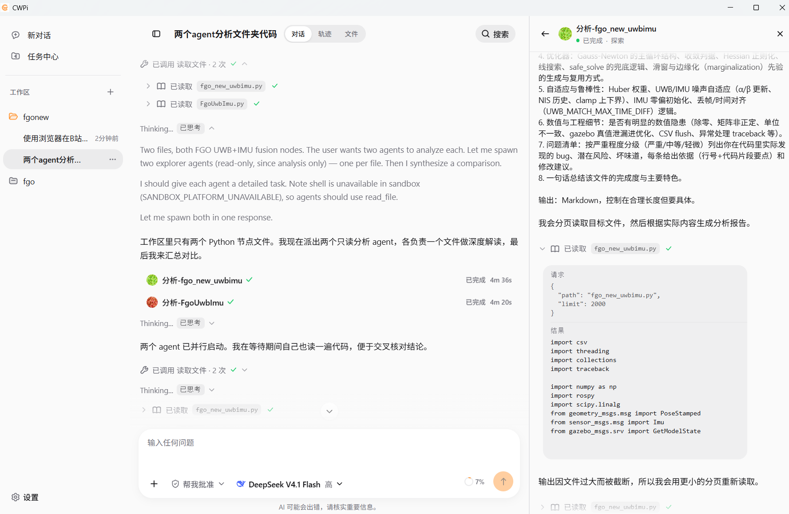
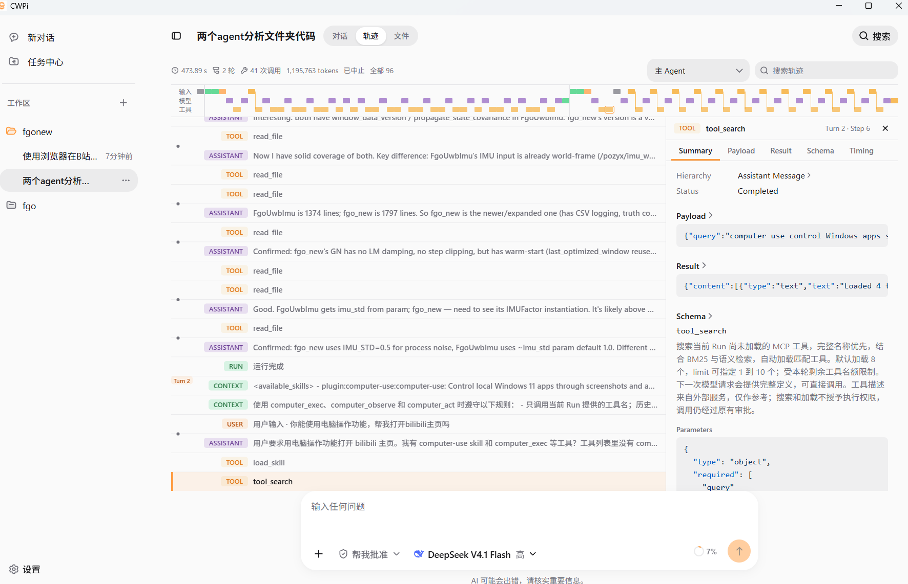
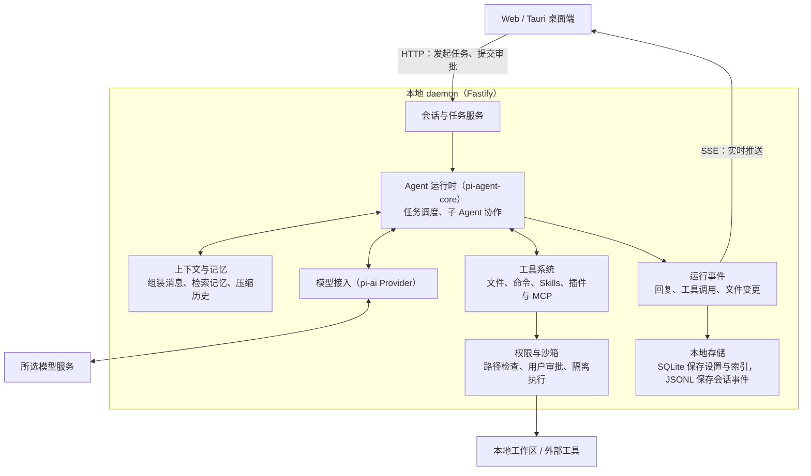

# CWPi


面向本地代码库的多智能体 Coding Agent，支持多智能体并行调查、代码修改与验证，并通过 Web 或桌面端实时展示执行过程。支持 Skills、插件及 MCP 扩展，可通过 Computer Use 完成点击、输入和滚动等操作。

## 项目介绍

CWPi 主要有以下功能：

1. **多智能体任务协作**：主 Agent 可将本地工作区中的任务分配给多个子 Agent 并行执行，并通过任务中心查看执行进度与结果。支持计划确认后执行，也可在运行过程中调整任务方向或排队提交后续指令。
2. **执行过程可视化**：实时展示 Agent 回复，并通过时间线记录主、子 Agent 的工具调用、审批及执行结果。支持查看文件修改差异，并按轮次撤销或重新应用已记录的代码变更。
3. **模型选择与扩展**：基于 pi-ai 的 Provider 体系接入内置及自定义模型服务，支持按日期和模型统计请求次数、Token 用量及预估费用，并通过 Skills、插件和 MCP 扩展 Agent 能力。
4. **记忆与会话管理**：通过个人记忆和项目记忆保存并复用用户偏好及项目背景，支持历史会话搜索、归档，以及上下文检查点的查看、对比与恢复。
5. **沙箱与权限管理**：结合路径校验、沙箱隔离和操作审批机制，限制文件写入、命令执行及工具调用的权限范围。

## 页面预览

### 使用展示



主 Agent 将两个代码文件交给子 Agent 并行分析，可在同一对话中展开查看各自的进度和工具调用。

### 执行轨迹展示



沿时间线查看模型请求和工具调用，点开任意一条工具调用即可查看参数、结果和耗时。

## 项目框架


CWPi 的 Harness 运行在本地 daemon 中，负责组织上下文、调度主 Agent 和子 Agent，并在权限允许时执行工具。



每轮执行时，Harness 先准备上下文，再请求模型。模型需要读文件、运行命令或调用其他工具时，Harness 会按权限策略处理，并把工具结果交回模型继续执行。

## 目录说明

```text
CWPi/
├── apps/
│   ├── web/                 # React 前端，提供对话、任务中心和轨迹视图
│   ├── daemon/              # 本地后端，管理工作区、会话和任务，并推送运行事件
│   └── desktop/             # Tauri 桌面端，负责启动本地服务和打包安装程序
├── packages/
│   ├── agent-runtime/       # Agent 执行循环、子 Agent 调度和上下文管理
│   ├── providers/           # 基于 pi-ai 接入模型服务
│   ├── tools/               # 文件、Shell 和网络工具，以及 Skills 和插件
│   ├── policy/              # 路径校验、权限判断和操作审批
│   ├── sandbox/             # 为 Shell 命令和本地 MCP 提供运行隔离
│   ├── computer-use/        # Windows 窗口观察与键鼠操作
│   ├── memory/              # 个人记忆与项目记忆的存储和检索
│   └── evals/               # 上下文管理与会话恢复评估
├── hero-ui-pro/             # 项目使用的 HeroUI Pro 兼容组件
├── scripts/                 # 环境变量加解密等辅助脚本
├── .github/workflows/       # GitHub Actions 工作流
├── package.json             # 项目级启动、构建和检查命令
└── pnpm-workspace.yaml      # 工作区成员与共享依赖版本
```

## 启动项目

### 本地启动（Web）

#### 1. 检查环境

安装 Node.js 24 或更高版本，然后检查 Node.js 和 pnpm：

```bash
node --version
pnpm --version
```

项目使用 `pnpm 10.33.2`。如果尚未安装 pnpm，可以通过 npm 安装：

```bash
npm install --global pnpm@10.33.2
```

#### 2. 安装依赖并启动

在项目根目录（`package.json` 和 `pnpm-workspace.yaml` 所在目录）依次执行：

```bash
pnpm install
pnpm dev
```

`pnpm install` 安装整个工作区的依赖，`pnpm dev` 同时启动 Web 前端和本地 daemon。保持终端运行，并在浏览器打开 <http://127.0.0.1:5173>。
daemon 默认使用 `4310` 端口，可以访问 <http://127.0.0.1:4310/api/health> 检查后端是否已启动。

#### 3. 配置模型与工作区

1. 打开「设置 → 模型」，选择一个 Provider，完成 API Key 或 OAuth 配置，并选择默认模型。
2. 点击左侧「工作区」旁的 `+`，添加要处理的本地项目目录。
3. 在该工作区中新建对话并输入任务。

### 桌面端启动（Windows 11 x64）

本项目已经打包好exe文件可以直接安装

1. 打开 GitHub 仓库的 **Releases** 页面，在对应版本的 **Assets** 中下载 `CWPi_0.1.0_x64-setup.exe`。
2. 双击安装包，按提示完成安装，然后从 Windows 开始菜单打开 **CWPi**。
3. 首次启动后，在「设置 → 模型」配置模型服务，再添加本地工作区即可开始对话。

安装包已包含 Web 前端、Node.js 和本地 daemon，打开 CWPi 时会自动启动所需服务。

如需在桌面版使用网页搜索，请先在同一台电脑上启动 [SearXNG](#网页搜索可选)。

## 扩展说明

### 自定义 Skill

每个 Skill 放在一个独立目录里，入口文件为 `SKILL.md`。根据使用范围选择存放位置：

| 使用范围 | 存放位置 |
| --- | --- |
| 仅当前工作区 | `<工作区根目录>/.agents/skills/<技能名>/SKILL.md` |
| 所有工作区（桌面端安装版） | Windows 下 `%USERPROFILE%\.CWPi\skills\<技能名>\SKILL.md` |
| 所有工作区（源码开发模式） | `<CWPi 源码根目录>/.CWPi/skills/<技能名>/SKILL.md` |

例如，给某个项目添加 `code-review` 技能：

```text
工作区根目录/
└── .agents/
    └── skills/
        └── code-review/
            ├── SKILL.md
            └── references/   # 可选，存放参考资料
```

`SKILL.md` 开头需包含 `name` 和 `description`，其中 `name` 要与目录名一致。添加后可在「设置 → 技能」查看和管理。已有的 `.claude/skills/` 目录也可以直接复用。

### 插件与 MCP

- **安装现有插件**：在「设置 → 插件市场」选择并安装。
- **开发自定义插件**：在源码的 `packages/tools/src/plugins/<插件名>/` 下放置 `manifest.yaml`。随插件提供的 Skill 放在该目录下的 `skills/<技能名>/SKILL.md`，并在 `manifest.yaml` 中声明。将插件 ID 加入 `packages/tools/src/plugins/index.ts` 的 `BUILT_IN_PLUGIN_IDS`，再重启源码版；要在安装版中使用，则需重新打包。
- **接入外部工具**：如果已有 MCP 服务，可在「设置 → MCP 服务器 → 添加服务器」填写服务地址和所需的鉴权信息。

### 网页搜索（可选）

Web 版和 Windows 桌面版通过本机 SearXNG 提供网页搜索。打开 Docker Desktop，在项目根目录运行：

```powershell
docker compose -f docker-compose.dev.yml up -d
```

源码用户也可以运行 `pnpm dev:docker`。

容器会自动生成并保存密钥。服务启动后，CWPi 会在调用 `web_search` 时连接 `http://127.0.0.1:8888`。如果已经有本机 SearXNG，可复用支持 JSON 搜索的实例，并在启动 CWPi 前用 `CWPI_WEB_SEARCH_URL` 指定地址。 [SearXNG 搜索 API](https://docs.searxng.org/dev/search_api.html)


### Computer Use

Computer Use 是 Windows 11 x64 上的内置插件。Agent 可以查看应用窗口的截图和可访问性结构，并通过点击、输入、滚动等操作完成任务。

桌面端安装版已内置 Windows helper，安装并启用 Computer Use 插件即可。
从源码启动时，请先安装项目依赖，再在项目根目录的 PowerShell 中运行 `pnpm.cmd --filter @cwpi/computer-use native:build`，构建完成后再启动 CWPi。

1. 打开「设置 → 电脑操控」，安装并启用 **Computer Use**，确认页面显示「Windows 桌面可用」。
2. 打开目标应用并保持桌面解锁，然后在对话中指定要操作的应用和任务。
3. 按对话中的提示批准窗口观察或具体操作。

### Windows Shell 沙箱（预览）

Windows 11 x64 上的 Shell 沙箱默认关闭，需要试用时可按以下步骤启用：

1. 打开「设置 → 沙箱」，启用 **Windows Shell 沙箱（预览）**。
2. 点击「初始化并启用」，按提示确认 Windows 管理员弹窗。
3. 初始化成功后，文件访问权限将自动设为「只读」。

由于底层 Sandbox Runtime（SRT）在 Windows 上的目录授权可能跨会话保留，影响工作区隔离，因此目前仅支持只读模式。Shell 命令可以读取项目文件，但无法写入工作区。Agent 仍可通过内置文件编辑工具修改代码。

#### 以完全访问权限执行 Shell

如需执行写入命令，可在「设置 → 沙箱」中关闭沙箱，并将「权限」中设置为「完全访问权限」。

此时，Shell 命令将以当前 Windows 用户权限直接执行，文件修改和 MCP 工具调用也会自动获批。
